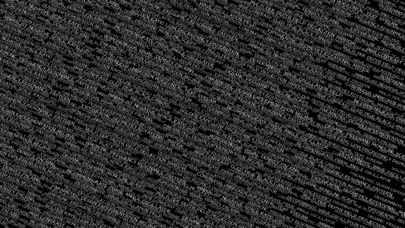
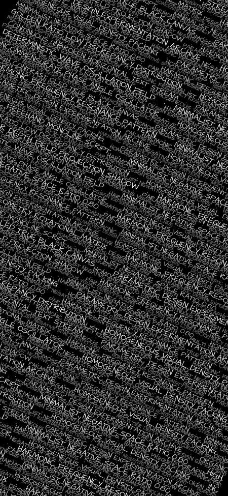
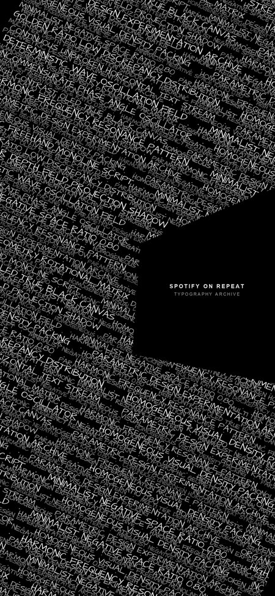

<div align="center">

# 🎵 Typography Wallpaper Generator
### Minimalist Organic Handwriting Wallpapers for OLED & 4K Displays

[](https://www.python.org/)
[](https://opensource.org/licenses/MIT)
[](https://en.wikipedia.org/wiki/OLED)
[]()

<br />

<p align="center">
  
</p>

<p align="center">
  
  &nbsp;&nbsp;&nbsp;&nbsp;
  
</p>

*Desktop 4K Panoramic Landscape & Mobile Lockscreen Editions with Badge Void*

</div>

---

## 📖 About The Project

Standard music wallpapers are often loud album art collages or automated year-end promotional graphics that feel cluttered on home screens.

This project approaches wallpaper design from an introspective, typographic angle:
- **Chalkboard & Journal Aesthetic**: Renders song lyrics and meaningful phrases as freehand handwriting on a deep black background, resembling personal notes on a chalkboard.
- **Pure OLED Black (`#000000`)**: Saves battery life on mobile OLED displays while providing infinite visual contrast against off-white lettering.
- **Mathematical Spatial Balance**: Employs **Golden-Ratio Low-Discrepancy Sampling** and **Harmonic Wave Equations** to distribute text with uniform density—eliminating clumping, harsh banding, and visual fatigue.
- **Dedicated Device Safe Zones**: Engineered around real device interfaces. Keeps the top clear for iOS dynamic islands and lockscreen clocks, and protects the bottom dock on desktop monitors.

---

## 🎨 Visual Rendering Engines

| Engine | Algorithm / Formula | Visual Characteristics |
| :--- | :--- | :--- |
| **Uniform Density** | $z_i = (0.382 + i \cdot \phi) \pmod 1$ | Perfectly homogeneous text distribution with continuous horizontal phase jitter. Zero clumping or gaps. |
| **Logical Chaos** | Multi-frequency harmonic oscillator | Deterministic wave-like crests and troughs of depth across background, midground, and foreground. |
| **Chaotic 3D** | Multi-tier Z-space planes | Variable tilt angles (-29° to -19°) breaking rigid grids, accented with black projection drop shadows. |
| **Super-Dense** | Line-spacing compression ($\rho \approx 0.73 - 0.82$) | 200+ lines packed tightly wall-to-wall for an intense, hypnotic lyrical texture. |
| **Editorial Minimal** | Safe-zone negative space layout | Generous breathing room, focused on centerpiece quotes with lockscreen clock and macOS dock clearance. |

---

## 📂 Project Architecture

```
.
├── generate.py                # Primary CLI runner (interactive + flags)
├── requirements.txt           # Dependencies (Pillow)
├── pyproject.toml             # Standard packaging specification
├── data/                      # Input datasets and templates
│   ├── lyrics.example.md      # Template for custom phrases & tracks
│   └── tracks.example.json    # JSON track schema template
├── fonts/                     # Bundled open-source TrueType handwriting fonts
│   ├── README.md              # Font license documentation
│   └── *.ttf                  # Architects Daughter, Caveat, Indie Flower, etc.
├── src/
│   └── spotify_wallpaper/     # Core modular package
│       ├── config.py          # Resolutions, colors, safe-zones
│       ├── font_loader.py     # Cross-platform font resolver & cache
│       ├── lyrics.py          # Markdown phrase parser & fallback pools
│       ├── spotify.py         # Zero-dependency OAuth client
│       ├── cli.py             # CLI parser & interactive menu
│       └── renderers/         # Modular rendering engines
├── scripts/                   # Standalone single-style execution scripts
│   ├── make_uniform_density_chaos.py
│   ├── make_logical_chaos.py
│   ├── make_chaotic_3d.py
│   ├── make_english_wallpapers.py
│   ├── make_super_dense.py
│   └── make_editorial.py
└── dist/                      # Default wallpaper output directory
    ├── phone/                 # 1290 x 2796 (iPhone / Android)
    └── desktop/               # 3840 x 2160 (4K UHD)
```

---

## ⚡ Quickstart

### 1. Installation

```bash
# Clone the repository
git clone https://github.com/heavens7above/spotify-lyrics-wallpaper.git
cd spotify-lyrics-wallpaper

# Install dependencies
pip install -r requirements.txt
```

### 2. Interactive Mode

Run without arguments to launch the guided interactive wizard:
```bash
python generate.py
```

### 3. Direct CLI Rendering

```bash
# Render recommended Uniform Density style (Phone & Desktop)
python generate.py uniform

# Render mobile wallpaper only (1290 x 2796)
python generate.py uniform -d phone

# Render 4K desktop wallpaper only (3840 x 2160)
python generate.py chaotic -d desktop

# Render to a custom output directory
python generate.py uniform -o ~/Desktop/MyWallpapers

# Render full collection (all 6 visual styles)
python generate.py all
```

---

## ⚙️ CLI Reference

```
usage: spotify-wallpaper [-h] [-d DEVICE] [--no-cutout] [-l PATH] [-o DIR] [-c N] [-v] [style]

positional arguments:
  style                 Style name: uniform, logical, chaotic, english, dense, editorial, all, fetch, list

options:
  -h, --help            Show this help message and exit
  -d, --device DEVICE   Target device: phone (mobile), desktop (4k), or all [default: all]
  --no-cutout           Skip generating lockscreen clock & badge void cutout variants
  -l, --lyrics PATH     Custom path to a curated lyrics markdown file
  -o, --output DIR      Custom destination directory for generated wallpaper PNGs
  -c, --fetch-count N   Number of Spotify tracks to paginate during fetch [default: 150]
  -v, --version         Show program's version number and exit
```

---

## 📝 Custom Lyrics & Offline Mode

You do not need Spotify credentials to create custom wallpapers. You can supply your own favorite lyrics and quotes via Markdown in `data/lyrics.md`:

```markdown
### 1. Song Title — Artist Name
> *"First resonant line / Second resonant line..."*
- **Album**: Album Title
- **Vibe**: Mood description
```

If no `data/lyrics.md` file is provided, the engine will automatically draw from its built-in typography phrase pool.

---

## 🎧 Spotify Ingestion (Optional)

To pull your listening history directly from Spotify:

1. Create a developer app at the [Spotify Developer Dashboard](https://developer.spotify.com/dashboard).
2. Set the **Redirect URI** to:
   ```
   http://127.0.0.1:8888/callback
   ```
3. Copy the template environment file:
   ```bash
   cp .env.example .env.spotify
   ```
4. Add your `SPOTIFY_CLIENT_ID` and `SPOTIFY_CLIENT_SECRET`.
5. Run the fetch workflow:
   ```bash
   python generate.py fetch
   ```

---

## 📐 Mathematical Specifications

### Golden-Ratio Low-Discrepancy Sampling
To achieve an organic scatter that remains uniformly dense from top to bottom, the vertical plane is sampled using:
```math
z_i = (0.382 + i \cdot \phi) \pmod 1 \quad \text{where} \quad \phi = \frac{\sqrt{5} - 1}{2} \approx 0.6180339887
```
This guarantees an even spread of foreground hero phrases, midground lines, and background texture without periodic clumping.

### Incommensurate Harmonic Oscillator
For dynamic organic wave oscillations across 3D depth planes:
```math
z(i) = 0.5 + 0.5 \cdot \left[ 0.50 \sin\left(\frac{2\pi i}{7.3}\right) + 0.32 \cos\left(\frac{2\pi i}{3.7} + 0.4\right) + 0.18 \sin\left(\frac{2\pi i}{13.1} + 1.2\right) \right]
```

---

## 📄 License

Distributed under the **MIT License**. Sourced typography fonts are open-source and licensed under the SIL Open Font License or Apache 2.0 (see [fonts/README.md](fonts/README.md)).
